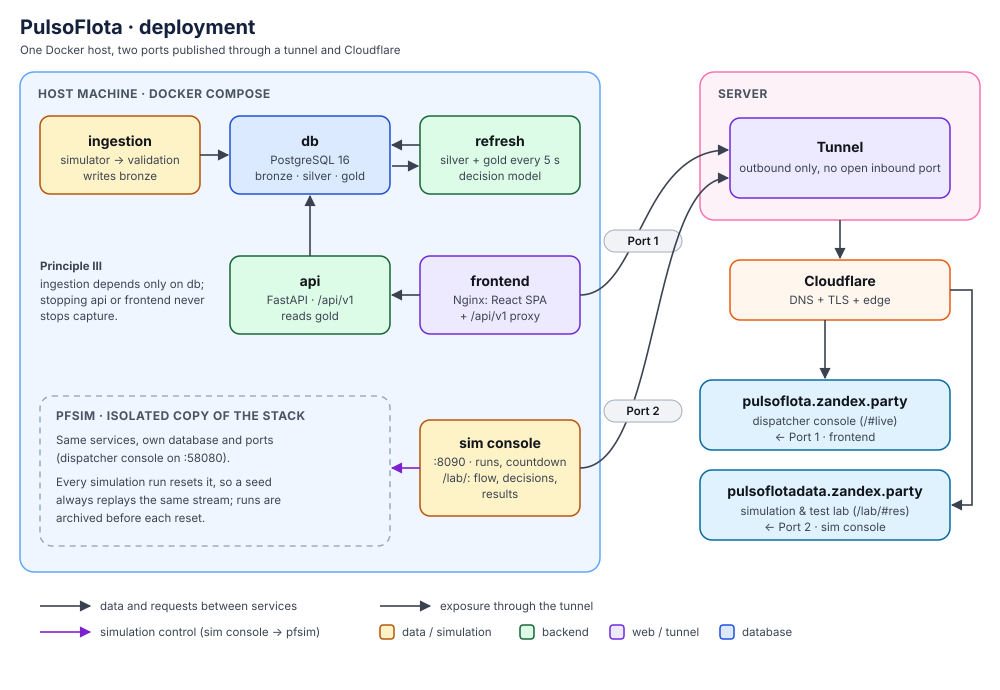
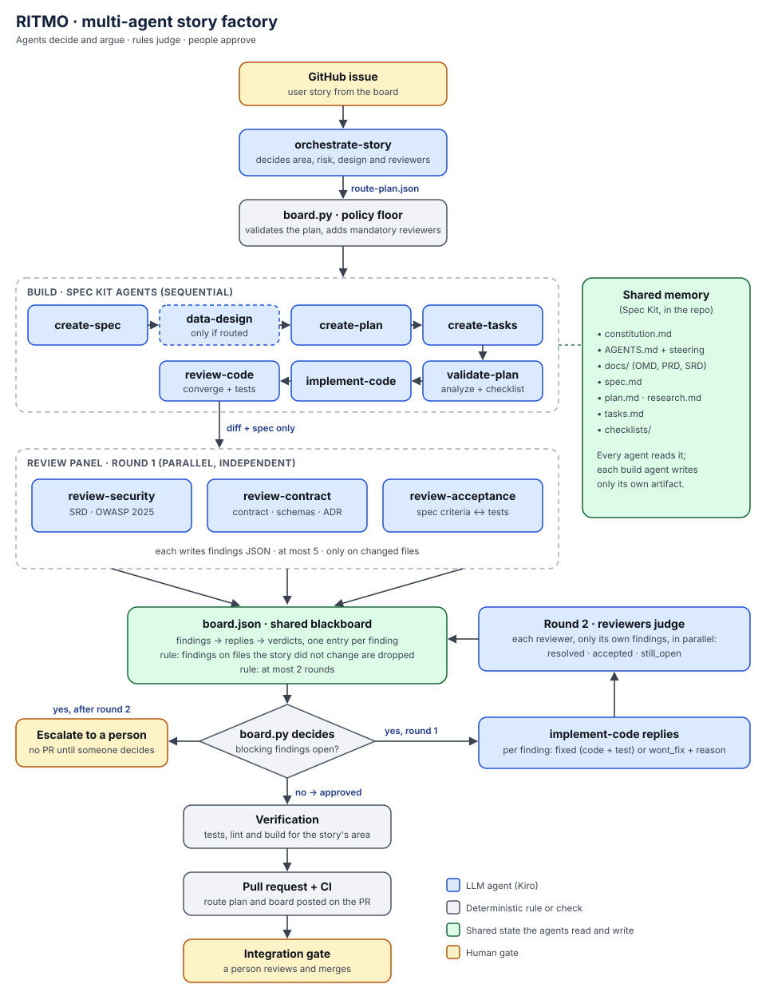

# RITMO / PulsoFlota

**PulsoFlota** is a real-time web control center for bus dispatchers in Medellín. It shows a corridor
live, detects bus bunching and gaps, recommends regulation actions (hold, reserve dispatch, …) and
lets the dispatcher approve or discard them: **the system recommends, the person decides**.

It is built with **RITMO** (Riesgo, Incrementos y Trazabilidad para la Movilidad Operativa — Risk,
Increments and Traceability for Operational Mobility), a risk-first spiral method, using
[GitHub Spec Kit](https://github.com/github/spec-kit) for Spec-Driven Development and a team of
[Kiro](https://kiro.dev) agents that build each story.

| Live environment | URL |
|---|---|
| **Dispatcher console** (the application) | <https://pulsoflota.zandex.party/#live> |
| **Simulation and test lab** (runs, decisions, results) | <https://pulsoflotadata.zandex.party/lab/#res> |

The user interface is in Spanish on purpose (it is for dispatchers in Medellín); the repository is
in English.

**Contents:** [Architecture and stack](#architecture-and-stack) ·
[Database](#database) · [Deployment](#deployment) · [Running locally](#running-locally) ·
[How it is built: SDD and agents](#how-it-is-built-sdd-and-agents) ·
[Repository layout](#repository-layout) · [Contributor setup](#contributor-setup)

---

## Architecture and stack



### Technology

| Layer | Technology |
|---|---|
| Frontend | React 19 + TypeScript 5.6 + Vite 6 + Tailwind CSS 3.4, served by Nginx (non-root, security headers) |
| Backend API | Python 3.12, FastAPI + Pydantic V2, uvicorn |
| Data pipeline | Python 3.12: synthetic simulator, ingestion with boundary validation, silver/gold refresh loop, decision model |
| Database | PostgreSQL 16, accessed with psycopg 3 and parameterized SQL only (no ORM) |
| Containers | Docker + Docker Compose (one service per concern; `pfsim` as an isolated copy for simulations) |
| Publishing | A tunnel on a server + Cloudflare (DNS, TLS) |
| CI | GitHub Actions: `contract`, `build`, `test` (pytest with coverage > 80 %), on every pull request |
| Quality | ruff, mypy, pytest, Vitest, ESLint, `tsc --noEmit` |
| Development | GitHub Spec Kit, Kiro agents (`kiro-cli`), Claude Code for independent verification |

### Services

| Service | Role | Port | Health check |
|---|---|---|---|
| `db` | PostgreSQL 16: bronze, silver, gold, config and ops schemas | `5432` | `pg_isready` |
| `ingestion` | Simulator → ingestion reader; validates every event and writes bronze (and rejections) | — | bronze freshness |
| `refresh` | Recomputes silver and gold every 5 s, runs the decision model, sends one `NOTIFY` per snapshot | — | gold freshness |
| `api` | FastAPI read API (`/api/v1`): corridor state, recommendations, decisions | `8000` | `GET /healthz` |
| `frontend` | Nginx: serves the React SPA and proxies `/api/v1` to `api` (one origin) | `8080` | local index returns 200 |
| sim console | Data team's console: starts and stops simulation runs on `pfsim`, mounts the data-flow lab at `/lab/` | `8090` | — |
| `pfsim` | Isolated copy of the stack used by simulation runs (dispatcher console on `58080`) | `58080` | same as above |

**Isolation (Principle III).** `ingestion` depends only on `db`. Stopping `api`, `refresh` or
`frontend` never stops data capture; the console shows a stale indicator and recovers on its own.

### Data flow

```
simulator ─▶ ingestion ─▶ bronze (raw, immutable) ──▶ silver (validated state) ──▶ gold (metrics,
              │             + rejections (reason)       refresh, every 5 s          recommendations)
              └ boundary validation (contract)                                          │
                                                                                         ▼
 dispatcher ◀── frontend (React) ◀── api (/api/v1, reads gold) ◀─────────────────────────┘
     │
     └─ approve / discard ─▶ decision recorded ─▶ simulator executes it (holds, reserve dispatch)
```

The read contract between data and backend is [`docs/data-contract.md`](docs/data-contract.md), with
JSON Schemas in [`contracts/`](contracts/) and decisions in [`docs/adr/`](docs/adr/).

---

## Database

PostgreSQL 16 with a medallion layout. The schemas are created by idempotent SQL scripts in
[`src/data/db/init/`](src/data/db/init/) (`001_schemas.sql` … `009_decision_mpc.sql`), mounted into
the container on first start; there is no ORM and no migration framework.

| Schema | What it holds | Examples |
|---|---|---|
| `bronze` | Raw events exactly as received, never updated or deleted; plus rejected events with their reason | `bronze.events`, `bronze.rejections` |
| `silver` | Validated, deduplicated state per bus and stop | `silver.bus_current_state`, `silver.stop_visits`, `silver.segment_traversals`, `silver.incidents` |
| `gold` | What the API reads: corridor snapshot, service metrics, recommendations and their evaluation | `gold.corridor_now`, `gold.service_metric`, `gold.recommendation`, `gold.mpc_projection`, `gold.source_status` |
| `config` | Reference data and settings: real stops and segments of route C6-008, demand and congestion by hour, fleet, decision model | `config.ref_stops`, `config.fleet_roster`, `config.decision_model` |
| `ops` | Operational health of the pipeline | ingestion health |

Every gold aggregate records the rules version and its bronze origin (lineage), so a service metric
can be reproduced and audited. Quality rules are deterministic code with tests, never an LLM.

---

## Deployment

The whole stack runs with Docker Compose on one host. Two ports are published to the internet
through a **tunnel** that runs on a separate server and connects outbound, so the host opens no
inbound port; **Cloudflare** provides DNS and TLS:

| Public hostname | Local service | What it is |
|---|---|---|
| `pulsoflota.zandex.party` | `frontend` (Nginx + SPA, `/api/v1` proxied to `api`) | Dispatcher console |
| `pulsoflotadata.zandex.party` | sim console (`:8090`, lab at `/lab/`) | Simulation runs, decisions and results |

The tunnel configuration lives on the server, not in this repository.

---

## Running locally

**Prerequisites:** Docker Engine with `docker compose`.

```bash
cp .env.example .env          # set POSTGRES_PASSWORD; keep DATABASE_URL in sync with it
docker compose up --build     # builds and starts db, ingestion, refresh, api and frontend
docker compose ps             # all five show (healthy)
```

Open **http://localhost:8080**. The console shows the C6-008 fleet, leader first, with state, headway
and data quality, refreshing about every 5 seconds. The defaults use `REFRESH_CLOCK=data`, so the
simulator drives the corridor; no extra data tooling or mocks are needed.

**Simulation console** (data team; runs on the isolated `pfsim` stack):

```bash
cp src/data/sim_console/.pfsim.env.example src/data/sim_console/.pfsim.env   # once; set POSTGRES_PASSWORD
uv run --frozen --extra dev python -m src.data.sim_console.app               # http://127.0.0.1:8090
```

Press **Demo completa** for a rehearsed 30-minute run with incidents and recommendations; see
[`src/data/sim_console/README.md`](src/data/sim_console/README.md).

**Test gates:**

```bash
docker compose --profile tools run --rm tests                 # backend pytest + coverage > 80 %
docker run --rm -v "$PWD":/repo -w /repo/src/frontend node:22.11.0-alpine \
  sh -c 'npm ci && npm run lint && npm test && npm run build'  # frontend lint/tsc/vitest/build
```

An end-to-end validation walkthrough lives in
[`specs/006-functional-integration/quickstart.md`](specs/006-functional-integration/quickstart.md).

---

## How it is built: SDD and agents

Every feature goes through **Spec-Driven Development** with Spec Kit: the constitution and the
steering files are the project's memory, and each story produces `spec.md` → `plan.md` → `tasks.md`
→ code under `specs/<id>-<name>/`. The agents do the writing; people approve at the gates.

### Spec Kit agents (the build pipeline)

Each agent wraps one Spec Kit command. In Kiro, a **handoff button** offers the next step after most
agents finish.

```
create-context            (standalone — run first / when docs change)
      │
create-spec ─▶ create-plan ─▶ create-tasks ─▶ validate-plan ─▶ implement-code ─▶ review-code
                                                                                       │
                                                                                       └─▶ implement-code   (loop back while work remains)
```

| Agent | Spec Kit prompt | What it does |
|-------|-----------------|--------------|
| **create-context** | `speckit.constitution` | Reads `docs/` and creates/updates `constitution.md`, `AGENTS.md`, and `.kiro/steering/` files. Standalone (no handoff). |
| **create-spec** | `speckit.specify` | Creates a feature spec under `specs/<id>-<name>/spec.md`. |
| **create-plan** | `speckit.plan` | Creates the technical plan + design artifacts for the current feature. |
| **create-tasks** | `speckit.tasks` | Generates `tasks.md`. Test tasks are **ON by default** unless the spec/constitution opts out. |
| **validate-plan** | `speckit.analyze` + `speckit.checklist` | Pre-implementation gate: cross-artifact consistency, then requirements-quality checklist. Stops on CRITICAL findings or missing `tasks.md`. |
| **implement-code** | `speckit.implement` | Executes `tasks.md` to write the code; marks tasks `[X]`. The only agent that edits source and runs build/test commands. |
| **review-code** | `speckit.converge` + `speckit.implement` | Finds unbuilt/incorrect work vs the spec, re-runs implement for it, then runs full tests + coverage, lint, format, and other validations; fixes what's safe or writes `specs/<feature>/review-findings.md`. Loops back to implement-code while gaps remain. |

**Typical first run on a fresh clone:** `create-context`, then `create-spec` with the feature you
want, then follow the handoffs. If `review-code` reports `tasks_appended`, re-run implement and
review until it reports `converged`.

### Data agents: a stricter path

Data stories (contract, ingestion, quality rules, simulator, metrics) go through more gates than the
rest:

| Extra control | What it does |
|---|---|
| **`data-design` agent** | Proposes the data architecture and the contract change as an ADR (`docs/adr/`) and a JSON Schema (`contracts/`). It writes no code. A person approves it at the **contract and data architecture gate** before planning |
| **Data profiles** (`.kiro/steering/data-profile-*.md`) | Load automatically when an agent touches data folders. They add mandatory tests (contract examples, idempotency, bronze immutability, duplicates, source outage, lineage) and a review checklist where a weakened rule or an undocumented field is **CRITICAL** |
| **CODEOWNERS** | The data owner must approve any change to `contracts/`, `src/data/rules/`, `docs/adr/` and `docs/data-contract.md` |
| **Contract review on every data change** | `docs/data-contract.md`, the schemas and the ADRs are checked together; in the multi-agent factory, `review-contract` is added by rule to every data story |

**Why.** The data path carries the project's highest risk:

- **Money and trust depend on it.** Service metrics (P(board ≤ t), excess wait time) feed the
  pay-for-quality scheme for operators. A wrong or tampered number is a contractual problem, not a
  cosmetic one. Data integrity is a **Level 1 risk** and data is the **Disciplined lane** of RITMO
  (turn 1, `docs/turns-ritmo.md`).
- **Everyone consumes it (Contract-First, Principle II).** The backend and the console read the
  contract; a silent change breaks them downstream.
- **Agents are tempted to make CI pass.** The cheapest way for an agent to turn a red test green is
  to loosen a threshold or drop a check. That is why changing a rule or the contract needs a human
  owner, and why **the rule judges the data, never an LLM**.

### The multi-agent story factory

On top of the Spec Kit pipeline, a team of agents takes a story from the board to a pull request.
An **orchestrator** decides the route, the Spec Kit agents build, and up to three **independent
reviewers** (security, contract, acceptance) check the diff **in parallel** and argue with the
implementer on a shared board. Deterministic rules in `factory/board.py` decide what moves forward,
and people approve.



| Agent | Role |
|-------|------|
| **orchestrate-story** | Reads the story and writes a route plan: area, risk, contract impact, design agents and reviewers, with reasons |
| **review-security** | SRD / OWASP 2025 review of the diff |
| **review-contract** | Contract-First review: `docs/data-contract.md`, schemas, ADRs |
| **review-acceptance** | Every acceptance criterion in `spec.md` implemented and proven by a test |

How the agents communicate, a guided example with a real story (#27) and an evaluation of how the
project uses SDD: [`docs/factory-multiagent.md`](docs/factory-multiagent.md).

### All agents at a glance

| Group | Agents | Where |
|---|---|---|
| Spec Kit build pipeline | `create-context`, `create-spec`, `create-plan`, `create-tasks`, `validate-plan`, `implement-code`, `review-code` | `.kiro/agents/` |
| Data | `data-design` + data profiles for development, testing and review | `.kiro/agents/`, `.kiro/steering/` |
| Multi-agent factory | `orchestrate-story`, `review-security`, `review-contract`, `review-acceptance` | `.kiro/agents/`, `factory/` |
| Independent verification | Claude Code checks the factory's output by running tests and CI before merge | outside the repo |

---

## Repository layout

| Path | What it is | Shared in git? |
|------|------------|----------------|
| `src/frontend/` | Dispatcher console (React + Vite + Tailwind) and its Nginx image | ✅ |
| `src/api/` | FastAPI read API | ✅ |
| `src/data/` | Simulator, ingestion, rules, refresh, decision model, sim console, lab, DB init scripts | ✅ |
| `contracts/` | JSON Schemas for events and the read contract, with valid/invalid examples | ✅ |
| `data/reference/` | Small reference cut of real Medellín data the simulator uses (raw sources are not committed) | ✅ |
| `docs/` | OMD, PRD, SRD, RITMO turns, data contract, ADRs, ops runbooks | ✅ |
| `specs/` | Per-feature Spec Kit artifacts (spec, plan, tasks, checklists) | ✅ |
| `factory/` | Multi-agent factory: message schemas and the deterministic coordinator (`board.py`) | ✅ |
| `.kiro/agents/`, `.kiro/steering/`, `.kiro/prompts/` | Agents, steering (project rules) and Spec Kit prompts | ✅ |
| `.specify/scripts/`, `.specify/templates/`, `.specify/memory/` | Spec Kit machinery and the constitution | ✅ |
| `.specify/feature.json`, `.specify/integrations/packages/` | Machine-local Spec Kit state | ❌ (git-ignored) |

---

## Contributor setup

Because the agents and all Spec Kit files are committed, **you do not need to install Spec Kit** —
cloning the repo gives you everything the agents need.

You need:

1. **Kiro** (IDE or CLI) — the agents are a Kiro feature. Install from [kiro.dev](https://kiro.dev).
2. **git**.
3. **Bash + `jq`** — the Spec Kit scripts are bash and use `jq` for JSON output.
4. **Docker** to run the stack, and **uv** for the Python tooling.

```bash
git clone <repo-url>
cd ritmo-app-team-5
```

Open the folder in Kiro. The agents appear in the **agent picker** (bottom bar of the chat input).

### Installing `jq`

```bash
brew install jq                                   # macOS (Homebrew)
sudo apt-get update && sudo apt-get install -y jq # Debian / Ubuntu
sudo dnf install -y jq                            # Fedora / RHEL
```

Without Homebrew on macOS, use MacPorts (`sudo port install jq`) or download the standalone binary
from the [jq releases](https://github.com/jqlang/jq/releases) (`jq-macos-arm64` for Apple Silicon,
`jq-macos-amd64` for Intel) and put it on your `PATH`.

**Windows:** the scripts are bash, so use **WSL** (recommended: `wsl --install`, then the Linux
steps) or **Git Bash** with `winget install jqlang.jq`. Run Kiro and the agents from inside WSL/Git
Bash so the `.specify/scripts/bash/*.sh` calls work.

Verify with `bash --version` and `jq --version`.

### Optional: the Spec Kit CLI

Only needed to scaffold Spec Kit into another project, upgrade the `.specify/` machinery, or run
`/speckit-*` commands outside these agents. Official guide:
<https://github.github.io/spec-kit/installation.html> (Python 3.11+, `uv` recommended).

```bash
uv tool install specify-cli     # or: pipx install specify-cli / pip install specify-cli
specify version
```

If you re-scaffold, keep the **bash** script variant (`specify init <project> --script sh`): the
agents in this repo call `.specify/scripts/bash/`.

---

## Notes

- **Per-feature state:** `.specify/feature.json` points at the current feature directory and is
  git-ignored (it's per-checkout). Each contributor's agents resolve the feature locally.
- **Committing:** the agents never commit for you (`git commit`/`push` are blocked in agent
  permissions). Review changes and commit yourself.
- **Coverage threshold:** 80 %, set in the constitution (Principle V) and enforced in CI.
- **Documentation:** product, architecture and security in [`docs/`](docs/) (OMD, PRD, SRD); the
  RITMO turn map in [`docs/turns-ritmo.md`](docs/turns-ritmo.md).
