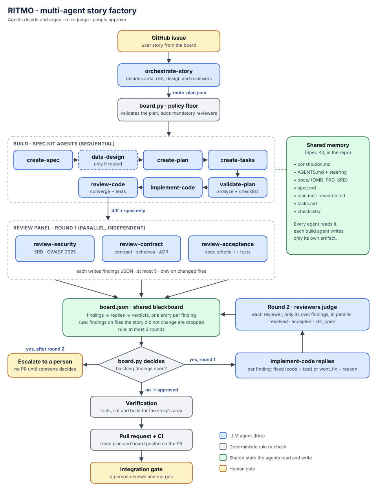

# Multi-agent story factory

How RITMO / PulsoFlota turns a user story into a pull request with a team of agents, how those
agents talk to each other, a guided example with a real story, and an evaluation of how the
project uses Spec-Driven Development (SDD).



---

## 1. From an SDD pipeline to a multi-agent factory

The first version of the factory ran the Spec Kit agents in a fixed order
(`create-spec → create-plan → create-tasks → validate-plan → implement-code ⇄ review-code`).
Each agent wrapped one Spec Kit command, a shell script decided the order, and agents only left
files for the next one. That is SDD split into stages, not a multi-agent system: nobody decided the
route, agents never ran at the same time, and no agent could challenge another.

The factory keeps Spec Kit as its backbone (memory and process) and adds four things:

| Added | What it means here |
|---|---|
| **An orchestrator that decides** | `orchestrate-story` reads the story and writes a route plan: area, risk, whether it touches the contract, which design agents and which reviewers take part, and why |
| **Parallel, independent agents** | Up to three reviewers work at the same time on the same diff, each with its own lens, without seeing how the code was built |
| **Communication** | Agents exchange typed messages (JSON, validated against `factory/schemas/`) on a shared board: findings, replies, verdicts |
| **Negotiation with limits** | The implementer answers each finding (`fixed` or `wont_fix` with a reason); each reviewer judges the answers to its own findings. At most two rounds; what stays open goes to a person |

**Agents decide and argue, rules judge, people approve.** The decisions that must be reliable
live in deterministic code (`factory/board.py`), never in a prompt.

---

## 2. The agents

| Agent | Role | Reads | Writes (only) |
|---|---|---|---|
| `orchestrate-story` | Decides the route for one story | The story, constitution, `docs/turns-ritmo.md`, `AGENTS.md` | `.factory/route-plan.json` |
| `create-spec` → `create-plan` → `create-tasks` → `validate-plan` | Spec Kit: specification, plan, tasks, pre-implementation gate | Spec Kit memory | `specs/<feature>/…` |
| `data-design` | ADR and contract schema, when the orchestrator routes the story through it | Data steering, ADRs, contracts | `docs/adr/`, `contracts/` |
| `implement-code` | Builds the feature; later answers the reviewers' findings | `tasks.md`, the board | Code, tests, `.factory/replies.json` |
| `review-code` | Converge against spec/plan/tasks, run tests, lint and coverage | Spec Kit memory, code | Code fixes, `review-findings.md` |
| `review-security` | SRD / OWASP 2025 lens | Diff, spec, SRD | `.factory/findings/` and `.factory/verdicts/` (its own file) |
| `review-contract` | Contract-First lens: contract, schemas, ADRs | Diff, spec, `docs/data-contract.md` | its own findings / verdicts file |
| `review-acceptance` | Every acceptance criterion implemented and proven by a test | Diff, spec | its own findings / verdicts file |

The seven Spec Kit agents and `data-design` are unchanged. The four new agents live next to them
in `.kiro/agents/`. Each agent's file permissions are declared in its frontmatter: reviewers cannot
edit code, the orchestrator cannot write anything but its plan.

---

## 3. How the agents communicate

The agents never call each other. They communicate through **two shared spaces**, and a
deterministic coordinator moves the work between them.

### 3.1 Shared memory: Spec Kit (sequential handoff)

The constitution, `AGENTS.md`, the steering files and the feature's `spec.md`, `plan.md`,
`tasks.md` and `checklists/` are the long-term memory. Every agent reads them; each build agent
writes only its own artifact, and the next agent starts from it. This is the SDD part: intent
first, code last, every step traceable to a file in the repo.

### 3.2 The board: typed messages between agents (blackboard)

For one story, `.factory/` is a blackboard the agents read and write:

| Message | Written by | Read by | Schema |
|---|---|---|---|
| Route plan | `orchestrate-story` | coordinator, runner | `route-plan.schema.json` |
| Findings (round 1) | each reviewer | coordinator, `implement-code` | `findings.schema.json` |
| Replies | `implement-code` | coordinator, each reviewer | `replies.schema.json` |
| Verdicts (round 2) | each reviewer, on its own findings only | coordinator | `verdicts.schema.json` |
| `board.json` | coordinator | runner, people, the PR comment | built by `board.py` |

Every message is validated against its schema. If an agent writes an invalid file, the coordinator
sends it back once with the exact error; if it is still invalid, the factory stops.

### 3.3 The coordinator: rules that no agent can override

`factory/board.py` holds the rules (tested in `tests/unit/test_factory_board.py`):

- **Policy floor.** The orchestrator may add reviewers, never drop the mandatory ones: every story
  gets `review-acceptance`; risk level 1, backend and platform stories get `review-security`;
  data stories and contract changes get `review-contract` (and `data-design` when a data story
  touches the contract).
- **Grounding.** A finding on a file the story did not change is dropped by rule.
- **Ownership.** A reviewer can only judge its own findings; every open finding needs a reply.
- **Bounded negotiation.** At most two rounds. Blocking findings (`blocker`, `major`) still open
  after round 2 escalate to a person, and no pull request is opened.

### 3.4 Parallelism and independence

The runner starts the reviewers as separate Kiro sessions at the same time. Each one sees only the
diff, the list of changed files and the spec, not the implementer's reasoning. A different model
family (Claude) verifies the result again after the factory, by running the tests.

---

## 4. Guided example: issue #27, the effect result rule

**Story.** A pure function that classifies the effect of an approved recommendation as `worked`,
`partial`, `did_not_work` or `no_data` (ADR-0007), with unit tests. Run on 2026-11-25.

### 4.1 Timeline

| Time | Agent | What happened | Duration |
|---|---|---|---|
| 09:39 | `orchestrate-story` | Area Data, risk 2, no contract change, no design agent. Chose only `review-acceptance`. Said it was unsure whether the rule should be risk 1 | 28 s |
| 09:39 | coordinator | Policy floor added `review-contract` (data story) | — |
| 09:40 | `create-spec` | Spec `011-effect-result-rule` | 38 s |
| 09:41 | `create-plan` | Reported a plan, research, data model and contract (see 4.4) | 47 s |
| 09:42 | `create-tasks`, `validate-plan` | Tasks and pre-implementation gate | 40 s + 29 s |
| 09:43 | `implement-code` | `src/data/rules/effect_result.py` and its tests | 59 s |
| 09:44 | `review-code` | Converged; 17 tests, 100 % module coverage, 652 area tests green | 81 s |
| 09:45 | `review-acceptance` ∥ `review-contract` | Round 1, **in parallel** | 24 s ∥ 27 s |
| 09:45 | `implement-code` | Replied to both findings | 26 s |
| 09:46 | `review-acceptance` ∥ `review-contract` | Round 2, **in parallel** | 20 s ∥ 21 s |
| 09:46 | coordinator | **Approved** | — |

About 7 minutes from issue to an approved board, with 12 agent sessions. Verification passed and the
factory opened [PR #68](https://github.com/santiagocano08/ritmo-app-team-5/pull/68) with the route
plan and the board as a comment. An independent check afterwards (Claude, by execution): 18 tests
green (17 plus the one added in reply to ACC-1), 100 % coverage of the rule module, `ruff` clean,
and only the story's files in the PR.

### 4.2 The conversation on the board

**ACC-1 · `review-acceptance` · major.** The spec says a saving above zero but below the threshold
is `partial` *regardless of headway*, but no test proves it: both partial tests use a headway
that improves. The reviewer showed it with a mutation: removing `observed_saving_s > 0 or` from the
rule would leave every test green.
→ **`implement-code`: fixed.** Added a test with a small saving and a headway that does not improve.
→ **`review-acceptance`, round 2: resolved.** It checked the new test against the same mutation.

**CON-1 · `review-contract` · minor.** The rule returns `no_data` in two cases that ADR-0007 and
`docs/data-contract.md` do not document (expected saving ≤ 0, missing EWT).
→ **`implement-code`: wont_fix.** The guards are needed (a ratio against a non-positive expected
saving is meaningless), and updating ADR-0007 belongs to the data owner when #26 wires the rule in.
→ **`review-contract`, round 2: accepted.** It withdrew the finding and noted that the guards are
now recorded in `research.md`, with the ADR update deferred to the data owner.

Two things only a team of agents produced here: a reviewer the orchestrator had not chosen (added
by rule) found a real gap between the code and the contract, and the implementer disagreed with a
finding and convinced the reviewer with a reason, instead of the pipeline just looping.

### 4.3 What a person still decides

- CON-1 leaves a follow-up for the data owner: document the two extra `no_data` conditions in
  ADR-0007 and the H3 table of `docs/data-contract.md`.
- The integration gate: the pull request is reviewed and merged by a person after CI.

### 4.4 What the example showed about the factory itself

- `create-plan` reported a complete plan, but `plan.md` was left as the unfilled template.
  The session log shows why: the agent wrote the file with a shell heredoc chained after
  `mkdir -p /tmp/x &&`, the `mkdir` failed, so the write never ran, and the agent did not check the
  result. `validate-plan` did not catch it; `review-code` recorded it only as a low finding. A
  targeted re-run of `create-plan` (write with the file tool, then grep for template placeholders)
  filled it in 45 s and the fix was pushed to PR #68. An agent's own report is not evidence.
- The issue named `effect.py` and `test_effect_rule.py`; the agents chose `effect_result.py` and
  `test_effect_result.py`. No reviewer flagged the difference because the spec, not the issue,
  became the source of truth.

Both lead to recommendations in section 5.3.

---

## 5. Evaluation: how the project uses SDD

Evidence from the repository on 2026-11-25: 15 feature specs in `specs/`, 34 merged pull requests.

### 5.1 What works

- **The full Spec Kit cycle is used for every feature.** All 15 features have `spec.md`, `plan.md`,
  `tasks.md`, `research.md`, `data-model.md`, `quickstart.md` and checklists; 11 have contracts.
- **The constitution governs.** All 15 plans include a Constitution Check; phased adoption by turn
  (`docs/turns-ritmo.md`) keeps deferred principles from blocking.
- **Specs drive the code.** 12 of 15 features have every task done; the two with open tasks
  (`004-scenario-injectors`, `006-decision-mpc`) deferred phases to tracked issues.
- **Contract-First is real for data.** Data changes go through `docs/data-contract.md`, schemas and
  ADRs, and now a dedicated reviewer checks it.

### 5.2 Gaps

| Gap | Evidence | Effect |
|---|---|---|
| **Checklist gate is bypassed in automation** | Every feature's domain checklist (`checklists/<topic>.md`) is left fully unchecked (15–44 open items each); only `requirements.md` is checked. `implement-code` should stop on unchecked items, but the factory runs it non-interactively with "do not ask questions" | `validate-plan` produces a quality gate nobody closes |
| **Clarification is skipped** | 0 specs with `[NEEDS CLARIFICATION]`; only 5 of 15 have a Clarifications section; the factory tells agents to assume and continue | Ambiguity becomes silent assumptions |
| **Agents' reports are trusted** | Example 4.4: an unfilled `plan.md` passed `validate-plan` | A missing artifact can pass the SDD gates |
| **Spec numbers collide** | `004`, `005`, `006` appear twice and `008` three times | Weaker traceability between spec, branch and PR |
| **Converge never appends** | No feature has a `Phase N: Convergence` in `tasks.md` | Either the code always matches, or the converge step is too lenient to tell |

### 5.3 Recommendations

1. **Artifact gate in the coordinator.** Before `create-tasks`, `board.py` checks that `spec.md`
   and `plan.md` have no template placeholders and that `tasks.md` cites existing FR ids. Fail
   fast instead of trusting the agent's summary.
2. **Close the checklist gate.** Let `validate-plan` mark the items it can verify and send the rest
   to the board as findings, so they get the same reply/verdict loop instead of being ignored.
3. **Clarify with a budget.** Allow up to three clarification questions per story and record the
   answers in the spec, instead of forbidding questions.
4. **Issue-to-spec traceability.** `review-acceptance` also checks the file names and commands the
   issue states, not only the spec.
5. **Unique spec numbers.** Allocate the next number from `main` before branching.

---

## 6. Controls and limits

- **No agent on the real-time path** (Principle III); the factory only builds.
- **Human-in-the-loop:** agents propose, rules decide what can move forward, people approve at the
  specification, contract and integration gates, and receive every escalation.
- **Least privilege per agent**, declared in each agent's frontmatter.
- **Grounded findings:** only on changed files, at most five per reviewer, with evidence.
- **Cost:** one story costs about 10–14 Kiro sessions; reviewers only run when the route needs them.

---

## 7. Running it

The factory runner lives with the team's Kiro scripts (outside this repository) and reuses the
chain's worktree, verification and PR steps:

```bash
zsh kiro-fabrica.sh 27              # full run: route, build, panel, verification, PR
zsh kiro-fabrica.sh 27 --simular    # show the route without calling Kiro
HASTA=panel zsh kiro-fabrica.sh 27  # stop after the review panel (no verification, no PR)
```

`demo-fabrica.sh <issue>` opens a herdr workspace with one pane per reviewer and a live board.
